# Catalog: which skill do I need?

Every skill and command in this marketplace, grouped by what you are trying to do.
Install with `/plugin marketplace add austek/ustekai-skills`, then enable the plugins you want.

Invoke a skill by typing `/<plugin>:<skill>` (for example `/pr-workflow-oss:land-pr-oss`) or by describing the task; Claude loads the matching skill from its description.

Slash-only skills never load from a description; type the command: `grill-me`, `grill-with-docs`, `handoff`, `to-questionnaire`, `wait-what`, `improve-codebase-architecture`.

## Start here

```mermaid
flowchart TD
    A([What are you doing?]) --> B{Stage}
    B -->|Not sure it is feasible| S1["spike"]
    B -->|Plan feels fuzzy| S2["grilling / grill-me / grill-with-docs"]
    B -->|Need a decision recorded| S3["design-doc / domain-modeling"]
    B -->|Starting a new repo| S4["scaffold-from-reference"]
    B -->|Writing code| C{Language?}
    B -->|Reviewing| R{What?}
    B -->|Shipping a PR| P{Where in the PR?}
    B -->|Cleaning up| U{What?}
    B -->|Session housekeeping| H{What?}

    C -->|Java / Kotlin / Scala| L1["language-personas: java-*, kotlin-*, scala-*, jvm-*, spring-standards, ktor-standards, /jvm, /kotlin, /scala"]
    C -->|Python| L2["language-personas: python-*, /python"]
    C -->|Rust| L3["language-personas: rust-*, /rust"]
    C -->|Learning it| L4["polyglot-tutor, jvm-systems-mentor"]

    R -->|My branch or a PR| R1["review-pr-oss"]
    R -->|Is this refactor really safe?| R2["verifying-code-claims"]
    R -->|Understand a big diff| R3["explain-diff-html"]
    R -->|Whole repo health| R4["audit / full-audit"]
    R -->|Architecture smells| R5["improve-codebase-architecture"]

    P -->|Open it| P1["create-pr-oss"]
    P -->|Get it green, answer reviewers| P2["land-pr-oss"]
    P -->|Keep watching CI| P3["babysit-pr-oss + babysit-pane"]

    U -->|Strip comments fast| U1["nuke-comments"]
    U -->|Strip and refactor so code explains itself| U2["prune-comments"]

    H -->|Context is bloated| H1["context-spend"]
    H -->|Handing work to a fresh agent| H2["handoff"]
    H -->|Last answer was confusing| H3["wait-what"]
```

## Plugins at a glance

| Plugin | Use it when | Pros | Cons |
|---|---|---|---|
| `language-personas` | You write or review Java, Kotlin, Scala, Python or Rust and want the agent to follow a rulebook | Rule-per-file standards, separate coding, testing and tooling skills, load only what applies | Opinionated; Go not covered; rules can conflict with a repo's own style |
| `pr-workflow-oss` | You open, review and land PRs on personal or open-source repos | Reads each repo's CONTRIBUTING, PR template and DCO/CLA rules; replies to threads it addressed but never resolves them, since closing a thread is the reviewer's call; bounded watch loops | GitHub only; needs `gh` authenticated; `review-pr-oss` delegates to `pr-review-toolkit`, which must be installed |
| `babysit-pane` | You run `babysit-pr-oss` and want a live view | Terminal pane plus printed fallback for web and mobile | Needs `pr-workflow-oss` 1.10.0 or later; pane shows in the terminal only |
| `architecture` | You design modules, record decisions or start a repo | Shared vocabulary (deep modules, seams), ADR and C4 output, HTML architecture report | Heavier than a quick sketch; some skills interview you before producing anything |
| `productivity` | A plan, decision or handoff needs sharpening | Short skills with one job each; most only talk, `grill-with-docs` also writes `CONTEXT.md` and ADRs | Interview skills are deliberately relentless; `grill-me`, `grilling` and `grill-with-docs` overlap |
| `dev-utilities` | Misc tooling: audits, comment cleanup, claim verification, remote sessions | Budget-capped audits, mechanical and structural comment removal, HTML diff explainer | Grab-bag; `claude-remote` needs tmux; `claude-settings-split` and `idea-mcp-tools` assume specific personal setups |

## Language personas

| Name | Type | Use when |
|---|---|---|
| `java-coding-standards`, `java-testing`, `java-tooling` | skill | Writing or reviewing Java; JUnit 5, Mockito, AssertJ; Gradle or Maven, static analysis |
| `kotlin-coding-standards`, `kotlin-testing`, `kotlin-tooling` | skill | Kotlin code, tests, Gradle and static analysis |
| `jvm-coding-standards`, `jvm-testing`, `jvm-tooling` | skill | Rules shared by Java, Kotlin and Scala: virtual threads, thread safety, Jackson, serialization, shared test and build practice |
| `spring-standards` | skill | Spring Boot services in Java or Kotlin: typed config, transactions, validation, Problem Details, JPA |
| `ktor-standards` | skill | Ktor servers in Kotlin: module structure, StatusPages, non-blocking handlers, Koin |
| `scala-coding-standards`, `scala-testing`, `scala-tooling` | skill | Scala code, ScalaTest or MUnit, sbt or Mill, Scalafix and Wartremover |
| `python-coding-standards`, `python-testing`, `python-tooling` | skill | Python code, pytest, ruff, mypy and uv |
| `rust-coding-standards`, `rust-testing`, `rust-tooling` | skill | Rust ownership and error handling, tests and benchmarks, clippy and Cargo layout |
| `jvm-systems-mentor` | skill | Socratic review of concurrency, memory and distributed JVM designs |
| `polyglot-tutor` | skill | Learning Rust or Python through exercises and compiler or traceback errors |
| `/jvm`, `/kotlin`, `/scala`, `/python`, `/rust`, `/c` | command | Switch the session into a Principal Engineer persona for that language |

Choose a skill when you want rules applied automatically by context. Choose a command when you want to force the persona for the whole session. `/c` is command-only: no C skills exist. Persona commands other than `/jvm` and `/kotlin` defer to the `# Code` section of your own `CLAUDE.md`, so they do little without one.

## PR workflow

| Name | Type | Use when | Trade-off |
|---|---|---|---|
| `create-pr-oss` | skill | Open a PR on a personal or open-source repo | Detects forks and conventions; asks before pushing |
| `review-pr-oss` | skill | Review any PR, or your own branch with `--branch` or `--uncommitted` | Thorough but spawns several review agents |
| `land-pr-oss` | skill | Drive one PR to green: read CI logs and feedback, draft fixes, push after confirmation, reply to threads | Asks before pushing and replying, so it needs you present |
| `babysit-pr-oss` | skill | Run `land-pr-oss` for a bounded number of CI cycles across a PR, repo, user or org | Costs tokens while CI runs; merges only with `--merge` |
| `review-comprehension` | skill | Not user-invoked. `review-pr-oss` adds a predict-and-quiz layer through it | None |
| `/babysit-pane`, `/babysit-panel` | command | Print watch state; show or hide the pane | Requires `babysit-pane` |

## Architecture

| Name | Use when |
|---|---|
| `spike` | "Can we...?" or "Is it feasible?"; time-boxed POC with a findings write-up |
| `design-doc` | ADR, design doc or proposal; C4 and sequence diagrams |
| `codebase-design` | Designing interfaces, finding deepening opportunities, placing seams |
| `domain-modeling` | Building or sharpening `CONTEXT.md` glossary and ADRs |
| `improve-codebase-architecture` | Scan an existing codebase and get an HTML report of deepening candidates |
| `scaffold-from-reference` | New service or repo; decide if it needs its own repo or belongs in an existing module |

## Productivity

| Name | Use when |
|---|---|
| `grilling` | Stress-test a plan, decision or idea through relentless questions |
| `grill-me` | Same, scoped to sharpening a plan or design |
| `grill-with-docs` | Same, and write ADRs and a glossary as answers arrive |
| `handoff` | Compact the conversation into a document a fresh agent can pick up |
| `to-questionnaire` | Turn an open decision into a Markdown questionnaire for someone else to answer |
| `wait-what` | Last message was unclear; re-explain in simpler language |

## Dev utilities

| Name | Type | Use when | Trade-off |
|---|---|---|---|
| `audit` / `/audit` | skill, command | Budgeted, sharded repo audit that reports, files issues, fixes in worktrees or opens PRs | Report mode is safe; `--act fix` and `--act pr` change the repo |
| `/full-audit` | command | `/audit` with every lane enabled | Broadest and most expensive |
| `/coderabbit-audit` | command | Run CodeRabbit on uncommitted changes, a path, PR or branch and summarize | Needs the CodeRabbit CLI and auth |
| `verifying-code-claims` | skill | Before approving a "mechanical" refactor, rename, version bump or suppression | Slower than skimming the diff |
| `explain-diff-html` | skill | Rich single-page explanation of a diff, branch or PR stack, with an independent critic | Produces an artifact, not review comments |
| `nuke-comments` | skill | Delete every comment in one mechanical pass | No judgment: license headers and load-bearing comments go too |
| `prune-comments` | skill | Delete comments and refactor so the code states what the comment said | Slower; rewrites code |
| `business-analysis` | skill | Impact analysis and acceptance criteria for a Jira ticket | Jira-oriented |
| `idea-mcp-tools` | skill | Tool-selection rules when the IntelliJ IDEA MCP server is connected | Useless without that server |
| `claude-remote` | skill | Start a Remote Control Claude session in tmux, optionally as a systemd user service | Needs tmux; Linux-centric |
| `claude-settings-split` | skill | Move profile-specific changes out of a shared `settings.json` | Assumes a dotfiles layout with `claude-profiles/` |
| `context-spend` | skill | Report context cost, estimate the saving from compacting, and warn once per threshold crossing when context passes a threshold | Costs are estimates from static prices; does not run `/compact` or `/clear` for you |
| `/analysis`, `/pr`, `/story` | command | Draft a technical analysis, PR description or user story | Apply voice rules from your project's `CLAUDE.md`; `/pr` uses a fixed Jira-based template, so it suits Jira workflows only |

## Keeping this page current

`scripts/check_catalog.py` fails CI when a plugin, skill or command is missing from this page, or when a table's first column names one that no longer exists. Update this page in the same commit as the change.
